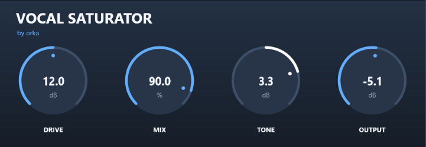

# Vocal Saturator

**A simple and powerful vocal saturation plugin.**

Vocal Saturator is a VST3 audio plugin designed to add warmth, harmonics, and character to vocal recordings. It provides straightforward controls for shaping the saturation and tonal balance of your sound.

Developed by **orka**.

---

## Features

- **Drive** – Controls the intensity of saturation.
- **Mix** – Blends the processed signal with the original signal.
- **Tone** – Adjusts the tonal balance from darker to brighter.
- **Output** – Controls the final output level.
- **4x Oversampling** – Helps reduce aliasing artifacts during saturation.
- **Smooth Parameter Transitions** – Reduces unwanted artifacts when adjusting controls.
- **Mono and Stereo Support**

## User Interface

Vocal Saturator features a clean, modern interface designed to keep the most important controls accessible.

## Installation

1. Download the latest Windows x64 VST3 release from the [Releases](../../releases) page.
2. Extract the downloaded ZIP archive.
3. Copy `Vocal Saturator.vst3` into:

   `C:\Program Files\Common Files\VST3\`

4. Restart your DAW or rescan VST3 plugins.
5. Load Vocal Saturator on an audio track.

## Compatibility

| Property | Support |
|---|---|
| Plugin format | VST3 |
| Platform | Windows |
| Architecture | 64-bit |
| Channel configurations | Mono / Stereo |
| Tested sample rates | 44.1 / 48 / 96 kHz |

## Technology

- C++
- JUCE Framework
- CMake
- VST3

## Development

Vocal Saturator is an independent audio plugin project developed by orka.

The project focuses on creating dedicated vocal-processing tools with simple interfaces and practical controls.

---

**Developed by orka**
